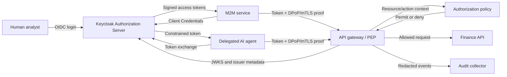

# Advanced OAuth, Delegation & Federated Identity

**Enterprise identity foundation · OAuth 2.0 · OIDC · RFC 8693 · DPoP · OAuth mTLS · RAR**

## Purpose and success criteria

Design a verifiable authentication and authorization foundation for machine-to-machine (M2M) services, human-initiated AI-agent delegation and protected financial APIs. Distinguish OAuth token exchange from explicit actor-aware delegation, and validate cryptographic proof-of-possession independently of ordinary bearer token validation.

**Acceptance criteria:** a service obtains a short-lived, audience-limited access token; the finance API enforces the intended action and report; the agent cannot broaden delegated rights; a stolen sender-constrained token cannot be reused without the corresponding key/certificate; invalid issuer, signature, audience, time window and authorization details are rejected.

## Logical architecture



**Trust boundaries:** TB1 clients versus authorization server; TB2 agent/M2M callers versus enforcement gateway; TB3 gateway versus policy service; TB4 protected API versus downstream systems; TB5 audit producer versus audit store. Validate JWTs locally using a trusted, cached JWKS with key-rotation handling. Do not treat token acquisition or transport encryption as authorization.

## Components

| Component | Planned role | Important controls |
|---|---|---|
| Keycloak (pinned version) | OIDC, OAuth clients, scopes, token exchange | Strict clients and grant settings, explicit audiences |
| Python M2M client | Client Credentials flow | Credentials stored outside source control |
| Delegated agent client | Exchange a user-context token for constrained access | Separate actor-aware experimental profile |
| FastAPI finance API | Synthetic reports endpoint | Object-level authorization and scope checks |
| Token validator / PEP | JWT verification and request enforcement | `iss`, `aud`, `exp`, `nbf`, algorithm, `cnf` |
| DPoP verifier | Proof checking | `htm`, `htu`, `ath`, `iat`, `jti`, thumbprint and replay cache |
| OAuth mTLS adapter | Certificate-bound token checks | Mutual TLS handshake and token-to-certificate binding |
| RAR experiment | Structured authorization request details | Validate requested grants and enforce granted rights |
| Audit emitter | Reproducible evidence | Correlation IDs and token-free event logging |

## Functional flows

### F1 - Machine-to-machine access

1. `billing-service` authenticates to the authorization server using Client Credentials.
2. The server issues a short-lived token intended for `finance-api` with `reports:read`.
3. The gateway validates its JWT, scope, audience and source identity.
4. `GET /reports/{id}` succeeds only for a permitted report.
5. The same token is denied against `admin-api`, another audience or a write action.

### F2 - Token exchange and delegated authority

1. An analyst signs in and requests a report analysis.
2. The agent requests a token appropriate to its downstream audience.
3. Demonstrate **standard client token exchange** separately from **explicit actor-aware delegation**. The latter may depend on preview or extension behavior in the pinned Keycloak release.
4. Authorization considers subject, actor (when supported), action, target resource, business unit and the delegation constraint.
5. Confused-deputy and privilege-amplification attempts return deny decisions.

**Standards caveat:** RFC 8693 token exchange is not by itself proof that actor-preserving, end-to-end delegation semantics are fully implemented.

### F3 - Sender-constrained access tokens

- **DPoP (RFC 9449):** issue a key-bound token; validate the DPoP proof's method, canonical target URI, access-token hash when required, timestamp, proof identifier and key thumbprint. Maintain a replay-detection cache and test wrong keys and repeated proofs.
- **OAuth mTLS (RFC 8705):** bind a token to a certificate and verify the certificate presented during the protected TLS connection matches the binding claim. Ordinary server-side TLS is not sufficient.
- Compare the operational implications, proxy boundaries, key management and revocation trade-offs of the two approaches.

### F4 - Rich Authorization Requests (RFC 9396)

Define a laboratory `authorization_details` type such as `financial_report_access` with `report_id`, `actions` and `business_unit`. Validate these values at the authorization stage and enforce the granted details at the resource server. Simply accepting a JSON object does **not** establish RAR compliance. Identify any custom Keycloak extensions and interoperability gaps.

## Suggested API contracts

| Interface | Example | Enforcement |
|---|---|---|
| `GET /reports/{report_id}` | Read a synthetic report | Correct audience, scope and report authorization |
| `POST /reports/{report_id}/analyze` | Request analysis | Delegated/actor context and constrained action |
| `POST /oauth/token-exchange` | Lab client exchanging token | Allowlisted audiences and requested token types |
| `GET /.well-known/openid-configuration` | OIDC provider metadata | Trusted issuer and supported endpoints |

Use `401` for invalid/missing authentication and `403` for authenticated but unauthorized access. Avoid echoing tokens or sensitive claims in responses.

## Proposed repository structure

```text
advanced-oauth-delegation/
├── README.md
├── Makefile
├── .env.example
├── compose.yaml
├── apps/
│   ├── finance-api/
│   ├── m2m-client/
│   ├── delegated-agent/
│   └── token-validator/
├── identity/keycloak/realm-export/
├── experiments/
│   ├── dpop/
│   ├── mtls/
│   ├── rar/
│   └── delegation-preview/
├── infrastructure/terraform/
├── tests/{unit,integration,security,contracts}/
├── scripts/{bootstrap,demo,evidence}/
├── docs/{architecture,adr,threat-model,controls,runbook}/
├── evidence/
└── .github/workflows/
```

## Test and evidence plan

| Test | Expected result | Required evidence |
|---|---|---|
| Valid M2M request | 200, correct report | Request ID and sanitized decision |
| Wrong `aud` or `iss` | 401 | Validation failure |
| Wrong JWT signing key / forbidden `alg` | 401 | Signature/algorithm rejection |
| Expired or not-yet-valid token | 401 | Clock-window verification |
| Replayed DPoP `jti` | 401 | Replay cache rejection |
| DPoP target URI or method mismatch | 401 | Proof binding failure |
| Certificate/token binding mismatch | 401 | OAuth mTLS binding failure |
| Delegated privilege amplification | 403 | Actor/resource policy denial |
| RAR action/resource mismatch | 403 | Granted-details enforcement |

## Threat model and architecture decisions

**Threats:** credential theft, token substitution, confused deputy, delegated privilege escalation, key rotation failures, replay, audience confusion and malicious client registration. Record abuse-case diagrams and residual risk for each trust boundary.

**Initial ADRs:** Keycloak version and supported grants; token format and JWKS rotation; standard exchange versus actor delegation; DPoP versus mTLS selection; RAR adapter design; access-token lifetime and revocation approach. Each ADR should capture alternatives, chosen option, consequences and verification.

## Delivery roadmap

1. Bootstrap Keycloak, M2M client and the protected API.
2. Add audience/scope/object authorization and negative JWT tests.
3. Implement and test DPoP and OAuth mTLS independently.
4. Add standard token exchange, then isolate the actor delegation experiment.
5. Add a scoped RAR experiment, threat model, audit evidence and release checklist.

## References

- [OAuth 2.0 Security Best Current Practice - RFC 9700](https://www.rfc-editor.org/rfc/rfc9700)
- [OAuth Token Exchange - RFC 8693](https://www.rfc-editor.org/rfc/rfc8693)
- [Rich Authorization Requests - RFC 9396](https://www.rfc-editor.org/rfc/rfc9396)
- [DPoP - RFC 9449](https://www.rfc-editor.org/rfc/rfc9449)
- [OAuth Mutual-TLS - RFC 8705](https://www.rfc-editor.org/rfc/rfc8705)
- [Keycloak documentation](https://www.keycloak.org/documentation)

## Enterprise scenario

If a human analyst requests a financial report review; an orchestrator agent delegates narrowly scoped work to a specialist; a protected API and MCP/RAG tools return synthetic records; a governance system captures ownership, approvals, access decisions and security findings. The four projects are individually demonstrable and designed to compose into one reference architecture.

## Security principles

- **Default deny and least privilege:** authenticate identities and authorize every sensitive operation and resource, not merely a successful login.
- **Explicit trust boundaries:** independent checks at identity providers, workload endpoints, gateways, policy engines and audit sinks.
- **Short-lived credentials and constrained delegation:** restrict audience, actions, time, identity and resource whenever supported.
- **Evidence-driven design:** attach a repeatable positive and negative test to every claimed security control.
- **No real financial or personal data:** use synthetic fixtures and local services. Never commit tokens, private keys, kubeconfigs or credentials.
- **Portable infrastructure:** prefer reproducible local Docker/Kubernetes tooling and Terraform Community Edition; require no paid services.

## Engineering workflow (target state)

The repository layout and commands below describe the **planned implementation**; they are not claims that the components have already been built. After implementation, document validated versions and exact prerequisites in `docs/runbook.md`.

1. Install the documented runtime versions and clone the repository.
2. Copy `.env.example` to a local `.env` and populate **development-only** values; do not commit `.env`.
3. Run `make bootstrap` to provision local dependencies, then `make up` for the lab.
4. Run `make test` and `make security-test`; capture deterministic pass/fail evidence in `evidence/`.
5. Run `make demo` for the documented allowed and denied scenarios, and `make down` to clean up.

**Suggested Makefile interface:** `bootstrap`, `up`, `down`, `lint`, `test`, `security-test`, `demo`, `evidence`, `clean`. Implement these targets and avoid adding commands to the README before they actually work.

## Documentation and delivery artifacts

Each repository is expected to contain the following **eight evidence categories**: (1) architecture diagram and trust boundaries, (2) architecture decision records, (3) running source code and local infrastructure, (4) automated unit/integration/security tests, (5) threat model, (6) risk-to-control/test matrix, (7) clearly identified limitations and residual risk, and (8) reproducible demo and logs. Prefer durable Markdown artifacts under `docs/` and redacted sample outputs under `evidence/`.

## CI/CD and repository protection

The planned pipeline should run Markdown and YAML linting, Python formatting/type checks, unit and integration tests, policy tests where applicable, dependency and container scanning, secret scanning, IaC validation and a build smoke test. Pin container image versions, dependencies and CI actions. Use branch protection, pull-request review and least-privileged workflow tokens. Never upload secrets as build artifacts; redact subject identifiers and claims from audit examples.

## Integrating the four repositories

| Repository | Primary contribution |
|---|---|
| `advanced-oauth-delegation` | OAuth/OIDC identities, delegated access tokens and API-side validation |
| `cloud-native-workload-identity` | Cryptographic identities for services and mutually authenticated transport |
| `agentic-ai-security-gateway` | Agent/tool invocation enforcement and fine-grained policy decisions |
| `nhi-governance-itdr` | Ownership, identity lifecycle, risk signals, access reviews and evidence |

Integration is **optional for local standalone demonstrations**. Document API contracts, trust domains and the expected failure mode before enabling cross-project scenarios. Authentication does not imply authorization; trust bundle federation does not imply access permission; an agent's output is never a policy decision.

## Scope and limitations

This is a reference laboratory and portfolio architecture, **not** a production-certified or independently audited security product. Prototypes, custom adapters, experimental provider features and standards still under development must be labeled as such. Production deployments would additionally require resilient key management, HA, telemetry/SIEM integration, formal operational controls, privacy review, disaster recovery and organizational approval.
